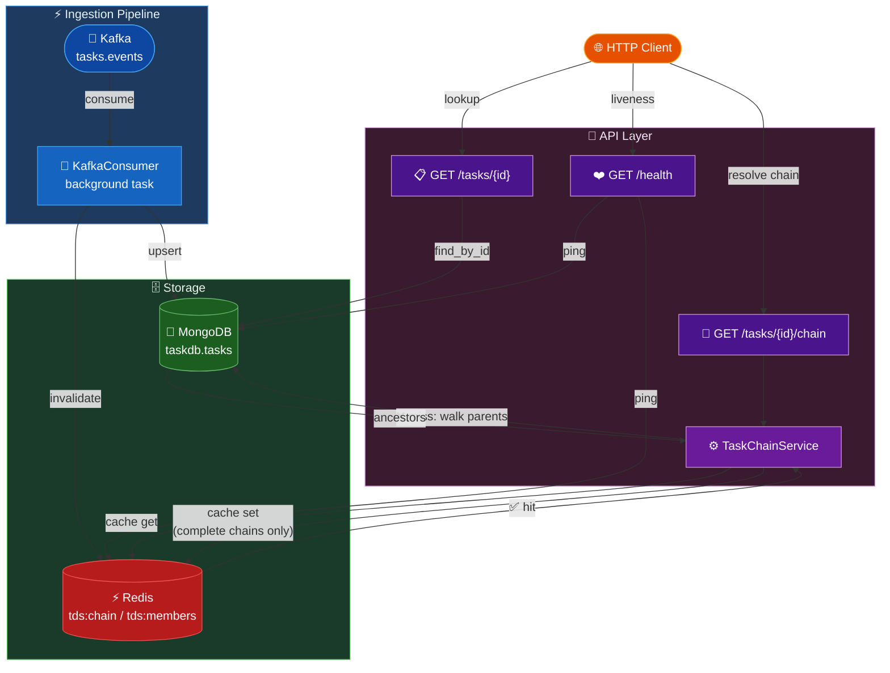

# Task Dependency Service

A backend service for a project management tool. Tasks stream in from Kafka, are persisted in MongoDB, and the service exposes a REST API to look up a task's full dependency chain. Dependency chains are cached in Redis.

## Stack

| Component | Technology |
|-----------|------------|
| API | Python 3.12 + FastAPI |
| Persistence | MongoDB (motor) |
| Cache | Redis |
| Event stream | Kafka (aiokafka) |

## Architecture



### Data flow — write path

A task event arrives on Kafka → `KafkaConsumer` deserialises the JSON and upserts the document into MongoDB → Redis cache entries for that task (and all cached chains that include it as an ancestor) are invalidated **before and after** the upsert. The double invalidation closes the race window where a concurrent reader could otherwise cache stale data between the two operations.

### Data flow — read path

`GET /tasks/{id}/chain` → `TaskChainService` checks Redis first. On a cache miss it fetches the full ancestor chain in a single `$graphLookup` aggregation query and writes the result to Redis — **only if the chain is complete** (reaches a root with no parent). Partial chains caused by out-of-order ingestion are never cached, so they resolve correctly once the missing parent arrives.

---

## 1. Prerequisites

- Docker + Docker Compose
- Python 3.12+

---

## 2. Start Infrastructure

```bash
docker compose up -d
```

> If Kafka fails to pull, see [Known Setup Notes → Kafka image](#kafka-image).

This starts Kafka, MongoDB, and Redis. Verify all three containers are running:

```bash
docker compose ps
```

---

## 3. Install Dependencies

```bash
python -m venv .venv && source .venv/bin/activate  # Windows: .venv\Scripts\activate
pip install -e ".[dev]"
```

---

## 4. Start the Application

```bash
uvicorn app.main:app --reload
```

The service starts at **http://localhost:8000**.  
Swagger UI: **http://localhost:8000/docs**

If port 8000 is already in use, pass `--port 8001` and update the base URL accordingly.

On startup the app will:
- Create a unique index on `tasks.id` in MongoDB
- Start the Kafka consumer (background task listening to `tasks.events`)

---

## 5. Run the Tests

```bash
pytest -v
```

Tests use in-memory fakes for MongoDB, Redis, and Kafka — no running infrastructure required.

To check code quality:

```bash
pylint app/
mypy app/ --ignore-missing-imports
```

---

## 6. Seed Tasks (End-to-End Demo)

> Requires the infrastructure from step 2 to be running (`docker compose up -d`).

### Option A — Default sample (3 tasks)

Publishes a chain: `t1 (root) → t2 → t3`

```bash
python scripts/produce_tasks.py
```

### Option B — Large dataset (100 tasks)

Publishes a linear chain of 100 tasks: `t1 → t2 → … → t100`

```bash
python scripts/produce_tasks.py --count 100
```

The running Kafka consumer will ingest all tasks into MongoDB automatically.

### Available flags

| Flag | Default | Description |
|------|---------|-------------|
| `--count N` | *(3-task sample)* | Generate a linear chain of N tasks instead of the named sample |
| `--bootstrap HOST:PORT` | `localhost:9092` | Kafka broker address |
| `--topic NAME` | `tasks.events` | Kafka topic to produce to |

---

## 7. Manual API Testing

### Endpoints

| Method | Path | Rate limit | Description |
|--------|------|------------|-------------|
| `GET` | `/tasks/{id}` | 120/min | Fetch a single task |
| `GET` | `/tasks/{id}/chain` | 60/min | Fetch the full ancestor chain |
| `GET` | `/health` | 30/min | Liveness + dependency probe |

Requests exceeding the rate limit receive `429 Too Many Requests`.

Task IDs must match `^[a-zA-Z0-9_-]+$` (letters, digits, `_`, `-`). Other characters return `422 Unprocessable Entity`.

### Look up a single task

```
GET /tasks/t1
```

Expected response:
```json
{
  "id": "t1",
  "title": "Task 1",
  "parent_task_id": null
}
```

### Get the full dependency chain

```
GET /tasks/t3/chain
```

Expected response (chain from t3 up to root):
```json
[
  {"id": "t2", "title": "Task 2", "parent_task_id": "t1"},
  {"id": "t1", "title": "Task 1", "parent_task_id": null}
]
```

The response includes two diagnostic headers:

| Header | Values | Meaning |
|--------|--------|---------|
| `X-Chain-Complete` | `true` / `false` | `true` = chain reached a root with no parent; `false` = a parent is missing or the depth limit (100) was hit |
| `X-Chain-Cycle` | `true` / `false` | `true` = a circular dependency was detected in the data |

### Root task returns empty chain

```
GET /tasks/t1/chain   →   []   (X-Chain-Complete: true)
```

### Non-existent task returns 404

```
GET /tasks/no-such-task/chain   →   404 {"detail": "Task not found"}
```

### Request tracing

Pass `X-Request-ID: <your-trace-id>` on any request and the same value is echoed back in the response header. If omitted, a 12-character ID is generated automatically. Useful for correlating logs with upstream traces.

---

## 8. Acceptance Criteria — Step-by-Step Demo

A Postman collection (`task-dependency-service.postman_collection.json`) covers all acceptance criteria. Import it into Postman, set `baseUrl` to `http://localhost:8000`, and follow the steps below.

### AC1 — Kafka-ingested task can be looked up

```bash
python scripts/produce_tasks.py
```

Then: `GET /tasks/t1` → 200 with task data.

---

### AC2 — Full ordered dependency chain

After seeding:

```
GET /tasks/t3/chain   →   [t2, t1]
GET /tasks/t2/chain   →   [t1]
```

---

### AC3 — Root task returns empty chain

```
GET /tasks/t1/chain   →   []
```

---

### AC4 — Non-existent task returns 404

```
GET /tasks/no-such-task         →   404
GET /tasks/no-such-task/chain   →   404
```

---

### AC5 — Out-of-order arrival

Demonstrates that the chain resolves correctly even when a child task arrives before its parent.

**Step 1** — Send the child (parent does not exist yet):

```bash
python -c "
import asyncio, json
from aiokafka import AIOKafkaProducer
async def run():
    p = AIOKafkaProducer(bootstrap_servers='localhost:9092')
    await p.start()
    await p.send_and_wait('tasks.events', json.dumps({'id':'t-child','title':'Child','parent_task_id':'t-parent-late'}).encode())
    await p.stop()
asyncio.run(run())"
```

**Step 2** — Query the chain (partial — parent not yet ingested):

```
GET /tasks/t-child/chain   →   200  []
X-Chain-Complete: false
X-Chain-Cycle: false
```

**Step 3** — Send the parent:

```bash
python -c "
import asyncio, json
from aiokafka import AIOKafkaProducer
async def run():
    p = AIOKafkaProducer(bootstrap_servers='localhost:9092')
    await p.start()
    await p.send_and_wait('tasks.events', json.dumps({'id':'t-parent-late','title':'Parent','parent_task_id':None}).encode())
    await p.stop()
asyncio.run(run())"
```

**Step 4** — Query the chain again (now complete):

```
GET /tasks/t-child/chain   →   200  [t-parent-late]
X-Chain-Complete: true
X-Chain-Cycle: false
```

---

### AC6 — Duplicate events do not corrupt data

Run the producer twice:

```bash
python scripts/produce_tasks.py
python scripts/produce_tasks.py
```

Then verify the task is not duplicated:

```
GET /tasks/t1   →   exactly one task, data unchanged
GET /tasks/t3/chain   →   still [t2, t1]
```

---

### AC7 — Performance (Redis caching)

Hit the same chain endpoint twice:

```
GET /tasks/t3/chain   →   200   (cache miss — computed from MongoDB)
GET /tasks/t3/chain   →   200   (cache hit — served from Redis)
```

Both responses return the same result. App logs show `Cache miss` then `Cache hit`.

---

### AC8 — Graceful degradation

**Redis down — falls back to MongoDB:**

```bash
docker compose stop redis
```

```
GET /tasks/t3/chain   →   200 with correct chain (no Redis, reads from MongoDB)
```

```bash
docker compose start redis
```

**MongoDB down — returns 503:**

```bash
docker compose stop mongo
```

```
GET /tasks/t1   →   503 {"detail": "Service temporarily unavailable"}
```

```bash
docker compose start mongo
```

---

## Connection Details

| Service | URL | Default Port |
|---------|-----|--------------|
| Kafka | localhost | 9092 |
| MongoDB | mongodb://localhost | 27017 |
| Redis | redis://localhost | 6379 |

Database: `taskdb`, Collection: `tasks`

---

## Known Setup Notes

### Kafka image

`bitnami/kafka:3.7` requires a paid Docker Hub subscription. Work around it by pulling the free Apache image and retagging it so Docker Compose finds the name it expects:

```bash
docker pull apache/kafka:3.7.0
docker tag apache/kafka:3.7.0 bitnami/kafka:3.7
```

`docker-compose.override.yml` is included in the repo. Docker Compose reads it automatically alongside `docker-compose.yml`, so no extra flags are needed — it replaces the Bitnami-specific environment variables with the equivalent Apache Kafka ones.

### Configuration

If your local ports differ from the docker-compose defaults (MongoDB 27017, Redis 6379, Kafka 9092), create a `.env` file. `.env.example` shows the format:

```bash
cp .env.example .env   # then edit the values to match your setup
```