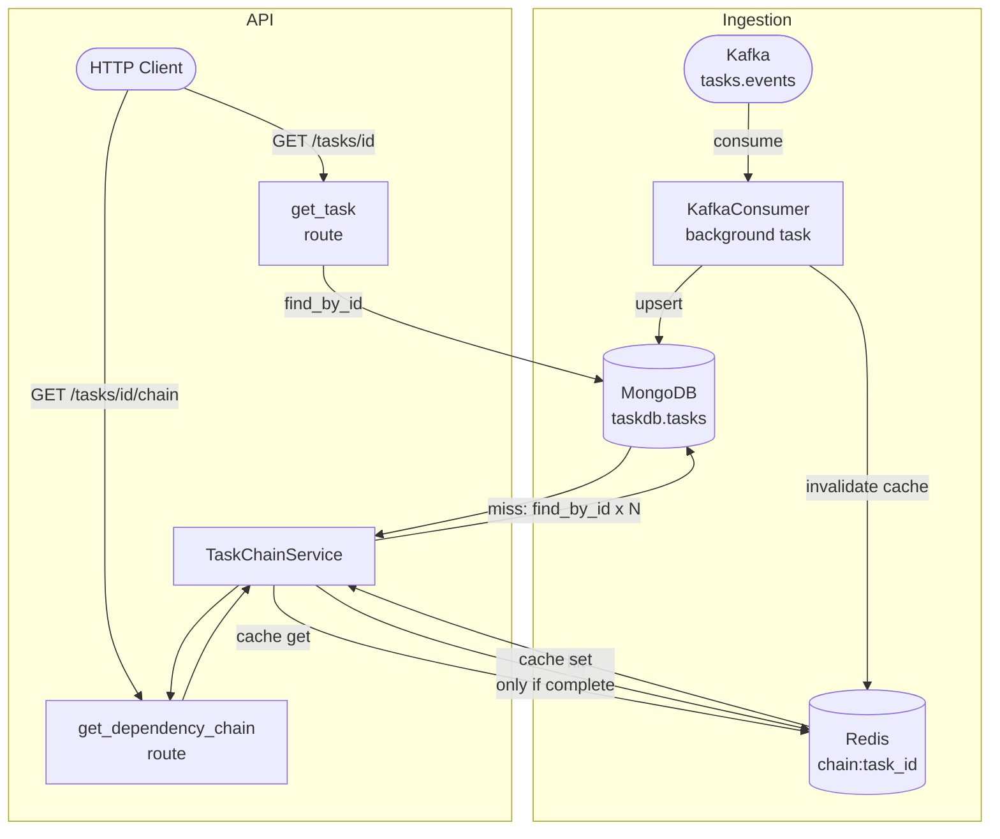

# Task Dependency Service

A backend service for a project management tool. Tasks stream in from Kafka, are persisted in MongoDB, and the service exposes a REST API to look up a task's full dependency chain. Dependency chains are cached in Redis.

## Stack

| Component | Technology |
|-----------|-----------|
| API | Python 3.11 + FastAPI |
| Persistence | MongoDB (motor) |
| Cache | Redis |
| Event stream | Kafka (aiokafka) |

## Architecture



### Data flow — write path

A task event arrives on Kafka → `KafkaConsumer` deserialises the JSON and upserts the document into MongoDB → Redis cache entry for that task is invalidated so the next read re-resolves the chain.

### Data flow — read path

`GET /tasks/{id}/chain` → `TaskChainService` checks Redis first. On a cache miss it walks the parent chain in MongoDB (one query per ancestor) and writes the result to Redis — **only if the chain is complete** (reaches a root with no parent). Partial chains caused by out-of-order ingestion are never cached, so they resolve correctly once the missing parent arrives.

---

## 1. Prerequisites

- Docker + Docker Compose
- Python 3.11+

---

## 2. Start Infrastructure

```bash
docker compose up -d
```

This starts Kafka, MongoDB, and Redis. Verify all three containers are running:

```bash
docker compose ps
```

---

## 3. Install Dependencies

```bash
pip install -e ".[dev]"
```

---

## 4. Start the Application

```bash
uvicorn app.main:app --reload --port 8001
```

The service starts at **http://localhost:8001**.  
Swagger UI: **http://localhost:8001/docs**

On startup the app will:
- Create a unique index on `tasks.id` in MongoDB
- Start the Kafka consumer (background task listening to `tasks.events`)

---

## 5. Run the Tests

```bash
pytest -v
```

Tests use in-memory fakes for MongoDB, Redis, and Kafka — no running infrastructure required.

To check code quality:

```bash
pylint app/
```

---

## 6. Seed Tasks (End-to-End Demo)

### Option A — Default sample (3 tasks)

Publishes a chain: `t1 (root) → t2 → t3`

```bash
python scripts/produce_tasks.py
```

### Option B — Large dataset (100 tasks)

Publishes a linear chain of 100 tasks: `t1 → t2 → … → t100`

```bash
python scripts/produce_tasks.py --count 100
```

The running Kafka consumer will ingest all tasks into MongoDB automatically.

---

## 7. Manual API Testing

### Look up a single task

```
GET /tasks/t1
```

Expected response:
```json
{
  "id": "t1",
  "title": "Task 1",
  "parent_task_id": null
}
```

### Get the full dependency chain

```
GET /tasks/t3/chain
```

Expected response (chain from t3 up to root):
```json
[
  {"id": "t2", "title": "Task 2", "parent_task_id": "t1"},
  {"id": "t1", "title": "Task 1", "parent_task_id": null}
]
```

### Root task returns empty chain

```
GET /tasks/t1/chain   →   []
```

### Non-existent task returns 404

```
GET /tasks/no-such-task/chain   →   404 {"detail": "Task not found"}
```

---

## 8. Acceptance Criteria — Step-by-Step Demo

A Postman collection (`task-dependency-service.postman_collection.json`) covers all acceptance criteria. Import it into Postman, set `baseUrl` to `http://localhost:8001`, and follow the steps below.

### AC1 — Kafka-ingested task can be looked up

```bash
python scripts/produce_tasks.py
```

Then: `GET /tasks/t1` → 200 with task data.

---

### AC2 — Full ordered dependency chain

After seeding:

```
GET /tasks/t3/chain   →   [t2, t1]
GET /tasks/t2/chain   →   [t1]
```

---

### AC3 — Root task returns empty chain

```
GET /tasks/t1/chain   →   []
```

---

### AC4 — Non-existent task returns 404

```
GET /tasks/no-such-task         →   404
GET /tasks/no-such-task/chain   →   404
```

---

### AC5 — Out-of-order arrival

Demonstrates that the chain resolves correctly even when a child task arrives before its parent.

**Step 1** — Send the child (parent does not exist yet):

```bash
python -c "
import asyncio, json
from aiokafka import AIOKafkaProducer
async def run():
    p = AIOKafkaProducer(bootstrap_servers='localhost:9092')
    await p.start()
    await p.send_and_wait('tasks.events', json.dumps({'id':'t-child','title':'Child','parent_task_id':'t-parent-late'}).encode())
    await p.stop()
asyncio.run(run())"
```

**Step 2** — Query the chain (partial — parent not yet ingested):

```
GET /tasks/t-child/chain   →   []
```

**Step 3** — Send the parent:

```bash
python -c "
import asyncio, json
from aiokafka import AIOKafkaProducer
async def run():
    p = AIOKafkaProducer(bootstrap_servers='localhost:9092')
    await p.start()
    await p.send_and_wait('tasks.events', json.dumps({'id':'t-parent-late','title':'Parent','parent_task_id':None}).encode())
    await p.stop()
asyncio.run(run())"
```

**Step 4** — Query the chain again (now complete):

```
GET /tasks/t-child/chain   →   [t-parent-late]
```

---

### AC6 — Duplicate events do not corrupt data

Run the producer twice:

```bash
python scripts/produce_tasks.py
python scripts/produce_tasks.py
```

Then verify the task is not duplicated:

```
GET /tasks/t1   →   exactly one task, data unchanged
GET /tasks/t3/chain   →   still [t2, t1]
```

---

### AC7 — Performance (Redis caching)

Hit the same chain endpoint twice:

```
GET /tasks/t3/chain   →   200   (cache miss — computed from MongoDB)
GET /tasks/t3/chain   →   200   (cache hit — served from Redis)
```

Both responses return the same result. App logs show `Cache miss` then `Cache hit`.

---

### AC8 — Graceful degradation

**Redis down — falls back to MongoDB:**

```bash
docker stop <redis-container-name>
```

```
GET /tasks/t3/chain   →   200 with correct chain (no Redis, reads from MongoDB)
```

```bash
docker start <redis-container-name>
```

**MongoDB down — returns 503:**

```bash
docker stop <mongo-container-name>
```

```
GET /tasks/t1   →   503 {"detail": "Service temporarily unavailable"}
```

```bash
docker start <mongo-container-name>
```

---

## Connection Details

| Service | URL | Default Port |
|---------|-----|-------------|
| Kafka | localhost | 9092 |
| MongoDB | mongodb://localhost | 27017 |
| Redis | redis://localhost | 6379 |

Database: `taskdb`, Collection: `tasks`

---

## Known Setup Notes

- `bitnami/kafka:3.7` requires a paid Docker Hub subscription. The workaround is to pull the free Apache image and retag it:
  ```bash
  docker pull apache/kafka:3.7.0
  docker tag apache/kafka:3.7.0 bitnami/kafka:3.7
  ```
  A `docker-compose.override.yml` is included that sets the correct environment variables for the Apache image.

- If port 8000 is already in use, start the app on a different port:
  ```bash
  uvicorn app.main:app --reload --port 8001
  ```